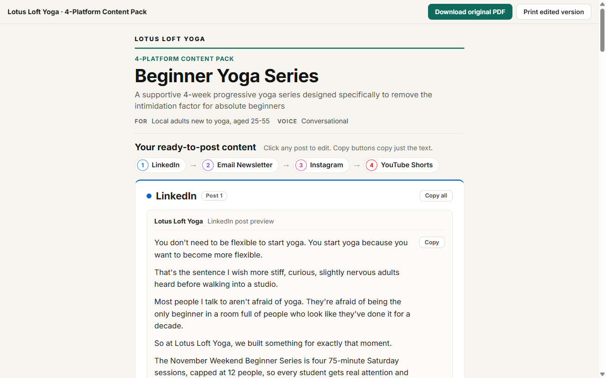
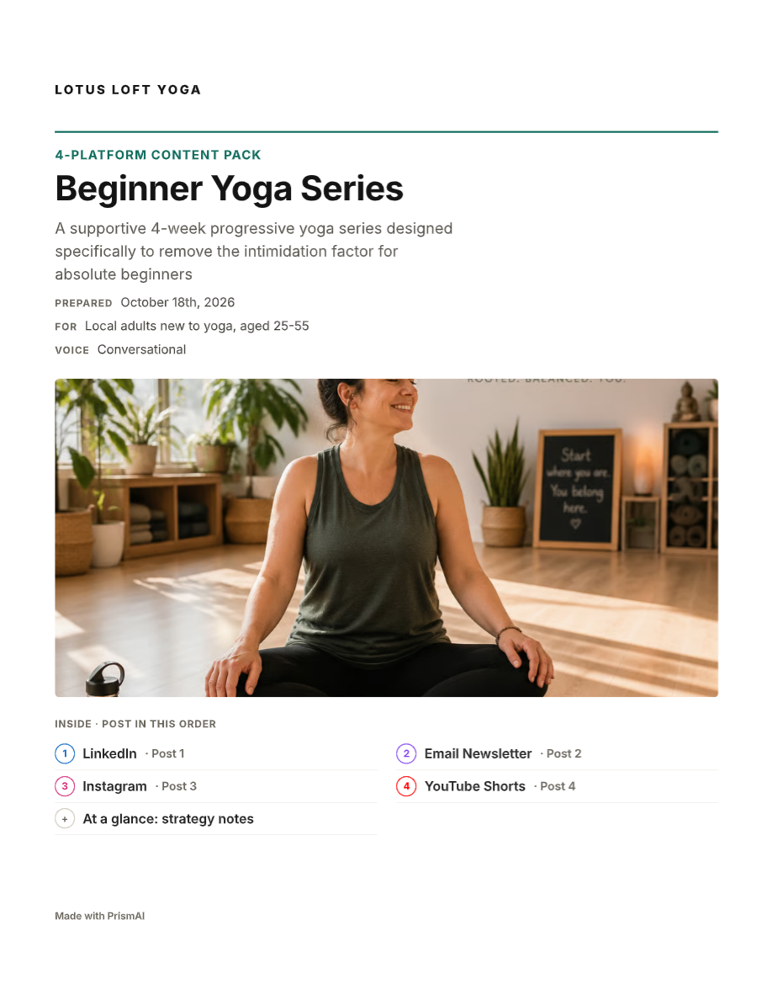
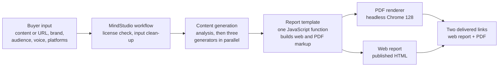

# PrismAI Content Repurposer

PrismAI turns one piece of content into platform-ready posts and delivers them as an editable web report and a print-ready PDF.

Small business owners, solo creators and early-stage founders buy it on Gumroad and Fiverr, typically for $10 to $50. They paste an article, transcript, notes or a URL, add their brand name, audience and voice, and get back posts for LinkedIn, Instagram, YouTube Shorts, an email newsletter and other platforms. Both results arrive as two public links, with no account needed.

## Live demo

- [Sample gallery](https://kirankri.github.io/prismai-content-repurposer/): every sample report, web and PDF
- [Latest web report](https://kirankri.github.io/prismai-content-repurposer/lotus-loft-yoga/report.html) (Lotus Loft Yoga, a fictional demo brand)
- [Latest PDF](https://kirankri.github.io/prismai-content-repurposer/lotus-loft-yoga/report.pdf)

<table>
  <tr>
    <td width="58%"></td>
    <td width="42%"></td>
  </tr>
  <tr>
    <td>Web report: every post is editable, each field has Copy, each card has Copy all</td>
    <td>PDF: US Letter, cover page and contents in posting order</td>
  </tr>
</table>

## How it works

- The buyer fills in one form. A license key from the purchase unlocks the run.
- One step analyses the source content (topic, argument, audience, angle). Three generators then write the posts in parallel, grouped by format: long form, short-form social, and video.
- A formatter step merges the posts into one structured report. Optional steps update the brand's saved voice and generate a cover image. If the image fails, the report still ships.
- A single report builder function turns that report into two outputs: the interactive web page and a print-clean PDF page. Sharing one builder keeps the two in sync.
- MindStudio renders the PDF with headless Chrome 128 and publishes both files. The buyer gets both links at the end of the run.

More detail: [docs/architecture.md](docs/architecture.md).

## What I built

- **Workflow design:** the full MindStudio pipeline, including license checks, URL or text input, parallel generation, optional image generation with failure logging, and saved brand voice.
- **Prompt design (described, not shown):** separate prompts for analysis, the three format groups, image direction and final formatting, each returning structured JSON so code can check and render it.
- **Report template:** a JavaScript builder that produces both the web report and the PDF from the same data.
- **Editing and copy UX:**
  - in-browser editing that is saved in localStorage and survives a reload;
  - per-field Copy;
  - Copy all, which copies only what gets pasted into that platform;
  - "Download original PDF" and "Print edited version".
- **Print and PDF layout:** US Letter, a cover page with the contents in posting order, and page breaks controlled with CSS only.
- **Testing:** unit tests for the extracted logic, tests that run each sample report's own script, and a PDF layout checker. See [Testing](#testing).

## Design iteration, by the numbers

Four review rounds on 17 and 18 October 2026, each measured in the browser and in the PDF text layer.

| Problem | Before | After |
|---|---|---|
| PDF body text | 6.7pt | 10.5pt |
| First Copy button on a phone | 2,658px | 791px |
| Post text width on a phone | 233px | 325px |
| Worst blank PDF page | 83% | 46% (round 4) |
| Lowest label contrast | 2.80:1 | 5.2:1 |
| Copy all pasting wrong content | Labels, slides, script | Values for that platform only |

Every fix round introduced a new regression, and the latest build is no exception: one PDF page is 72.5% blank. The full story, with how each number was measured: [docs/design-iterations.md](docs/design-iterations.md).

## Engineering notes

- **Chrome 128 PDF renderer.** It ignores CSS page-margin boxes, so the PDF cannot have running headers or page numbers. The cover page carries a contents list in posting order instead.
- **Page breaks with CSS only.** The renderer gives no control beyond `break-*` rules. Headings stay with their first lines, small blocks (hashtags, timeline rows) never split, and cards are allowed to break. Keeping whole cards together had left a page 64% empty.
- **Screen media at 1280px, scaled to the page.** The renderer lays the page out 1280px wide and scales it to fit Letter. PDF font sizes are set in viewport units, so they land at 10.5pt body text after scaling.
- **No git in MindStudio.** The prompts, functions and builder live in a private repo. Changes go through a written manual loop: edit, test, paste into the block, run a test report, log the change.
- **Links I do not control.** MindStudio hosts the delivered files. The samples here are copies with local images, so the gallery keeps working if those links expire.

Details and the other decisions: [docs/architecture.md](docs/architecture.md), [docs/decisions.md](docs/decisions.md).

## Testing

`npm test` runs four groups of tests:
- unit tests for the timeline label parser and the Copy all field selection, extracted from the report builder as pure functions;
- tests that load every sample report, run its own script, click Copy all on each card and check the clipboard text;
- a PDF layout checker that reads the PDF text layer with pdf.js and flags page size, small text, blank space, page-top fragments and stranded headings;
- a check that runs the PDF checker on every sample.

The older samples are kept on purpose: the tests confirm the checks catch the bugs each round shipped with. CI runs everything on every push. Details and the current checker output: [docs/testing.md](docs/testing.md).

## What I would do next

TODO(KK): what you would build or change next.

## About this repo

PrismAI is a live commercial product. The prompts, the full workflow and the full report builder are private. This repo holds the rendered sample reports, two small utilities extracted from the builder, the tests and the documentation. It is shared for review only (see [License](#license)).

## License

All rights reserved. The code, samples and docs are shared for review only. No license is granted to copy, modify or redistribute them.
