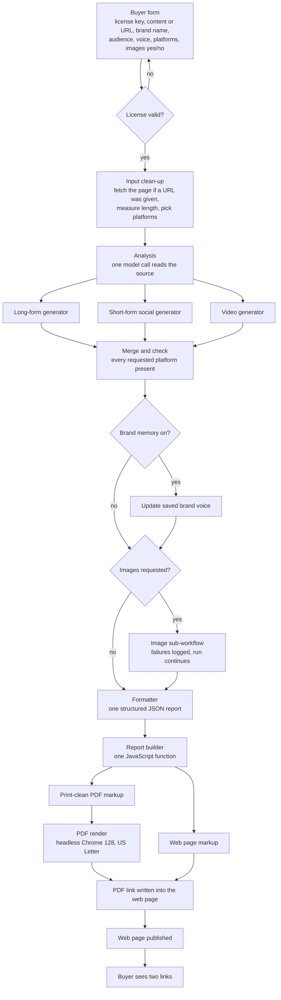

# Architecture

PrismAI runs as one workflow in MindStudio, a no-code builder for multi-step model workflows. MindStudio provides the form, the model calls, JavaScript function blocks, file rendering and hosting. Everything PrismAI-specific is in the prompts and in the JavaScript blocks I wrote.

This page describes the pipeline at the level of stages. The prompts and the block-by-block map are private.

## Pipeline

### Stages

1. **Form and license.** The buyer enters the license key from their purchase. The key is checked against the sales records before the content form appears. An invalid key shows the reason and asks again.
2. **Input clean-up.** If the content is a URL, the page text is fetched. The length is measured, and the chosen platforms are turned into a list of platform keys (all ten if none are chosen).
3. **Analysis.** One model call reads the source and returns a structured summary of it. Every generator gets that summary, so they agree on the facts.
4. **Generation.** Three model calls run in parallel, one per format group. Grouping by format keeps each prompt focused. Because the calls run in parallel, the run waits for the slowest of the three rather than all three in turn.
5. **Merge and check.** A function merges the three outputs and records any platform that came back missing.
6. **Optional steps.** Brand memory saves the buyer's voice for their next run. The image sub-workflow writes an image prompt and generates a cover image. An image failure is logged and the report is delivered without the image.
7. **Formatter.** A final model call produces one JSON report: metadata, the posts per platform, a posting order and the strategy notes.
8. **Report builder.** One JavaScript function turns the JSON into two HTML strings. One is the interactive web page. The other is a print-clean page for the PDF with a cover, no toolbar, no buttons and no script.
9. **Render and publish.** MindStudio renders the PDF and hosts it. A small function writes the PDF link into the web page's "Download original PDF" button, and the web page is published. The buyer sees both links.

## The report

One builder makes both outputs from the same data, so the PDF and the web page cannot drift apart.

Web page:
- Cards in the recommended posting order, each with a coloured platform header.
- Every post field is editable in place. Edits are saved in `localStorage` per report and restored after a reload, keeping formatting such as bold slide titles.
- Each field has a Copy button that copies the value only. Each card has Copy all, which copies only the fields that are pasted into that platform. For example, it leaves out carousel slides, spoken scripts, on-screen overlays and B-roll ideas. Fields left out are marked `data-all="0"` in the markup.
- "Download original PDF" fetches the hosted PDF. "Print edited version" prints the edited page with the same paged layout as the PDF.
- Reset (undo all edits) appears only after something has been edited.
- Video timelines split the model's raw timing text ("Appears at 0-3s, during hook") into a short time label (`0–3s`) and a phase line ("During hook").

PDF:
- US Letter, 0.6in margins (0.65in at the bottom).
- Cover page with the brand, title, audience, voice, cover image and a contents list in posting order.
- Strategy notes as an appendix at the end.

## Constraints and workarounds

| Constraint | Effect | Workaround |
|---|---|---|
| The PDF renderer is headless Chrome 128 | Chrome 128 ignores CSS page-margin boxes (`@bottom-right` and the like), so there are no running headers or page numbers | A contents list on the cover, in posting order, and clear platform headers on every card |
| Only CSS `break-*` rules control pagination | No way to measure and move content per page | Headings use `break-after: avoid`. Small blocks (hashtags, timeline rows, list items) use `break-inside: avoid`. Cards may break, because keeping whole cards together left a page 64% empty. The Instagram preview frame is kept whole. |
| The renderer lays the page out 1280px wide (screen media) and scales it to Letter | Fixed font sizes come out at about 64% of their CSS size | PDF font sizes are set in `vw` units so they land at 10.5pt body text and 7.9pt labels after scaling |
| MindStudio has no git integration and no export | No history, no diffs, no tests inside the tool | A private repo is the source of record. A written sync loop covers edit, test, paste into the block, run a test report and log the change. The editor's clipboard JSON is kept as a snapshot to diff against. |
| The delivered links are hosted by MindStudio | I do not control how long they last | The samples in this repo are copies with local images and a local PDF |
| Model output varies in shape | Field names and list shapes are not always the same | The builder normalises field-name variants, strips code fences and drops empty or duplicated fields before rendering |
| Image generation can fail | The report still has to ship | The image runs as a sub-workflow with errors ignored. Failures are written to an error log and the report is delivered without the generated image. |

## What is public and what is not

Public (this repo): the rendered sample reports, two pure functions extracted from the builder (the timeline parser and the Copy all field selection), the tests and these docs.

Private: every prompt, the workflow map, the model settings and the report builder source. The rendered samples do contain the report's front-end code, as every delivered report does.
